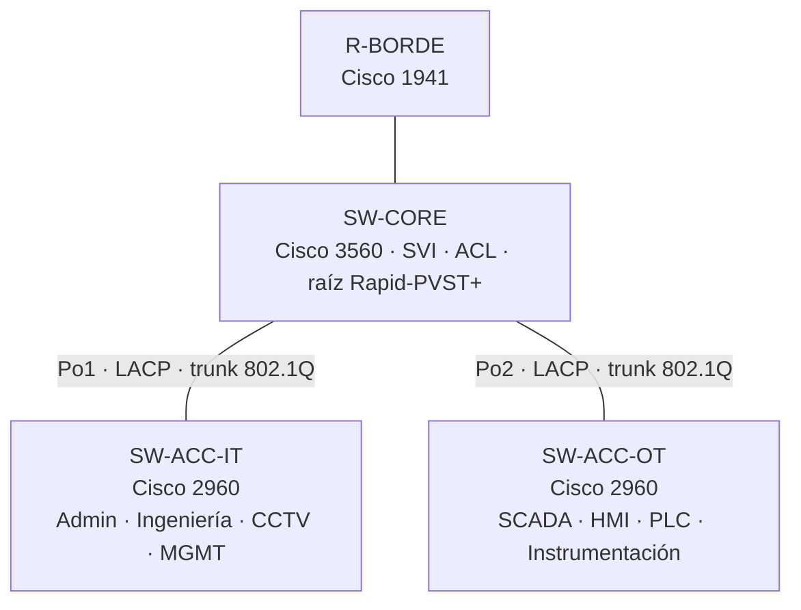

# Diseño, implementación y segmentación IT/OT de la red de datos del Complejo de Refinación Norte


> Laboratorio N.° 1 del curso **MT-335 – Comunicación de Datos y Redes Industriales** (Ingeniería Mecatrónica, Universidad Nacional de Ingeniería, Perú, ciclo 2026-2).
> Proyecto grupal: rediseño de una red plana en una arquitectura jerárquica segmentada, con separación entre las zonas IT (tecnologías de la información) y OT (tecnologías de la operación).

<!-- Opcional: reemplazar por la captura de la topología final -->
<!--  -->

---

## Tabla de contenidos

1. [Resumen](#resumen)
2. [Problema](#problema)
3. [Solución implementada](#solución-implementada)
4. [Resultados verificados](#resultados-verificados)
5. [Estructura del repositorio](#estructura-del-repositorio)
6. [Cómo reproducir el proyecto](#cómo-reproducir-el-proyecto)
7. [Limitaciones y mejoras propuestas](#limitaciones-y-mejoras-propuestas)
8. [Mi contribución](#mi-contribución)
9. [Equipo](#equipo)
10. [Referencias](#referencias)

---

## Resumen

El Complejo de Refinación Norte (caso simulado) operaba con una red plana: equipos administrativos, estaciones de ingeniería, servidores SCADA, PLC y cámaras de videovigilancia compartían un único dominio de difusión. Este proyecto documenta el rediseño completo de esa red en **Cisco Packet Tracer**, validado con **Wireshark**, aplicando:

- Direccionamiento IPv4 con **VLSM** a partir del bloque `172.20.0.0/22`.
- Segmentación con **VLAN** y enlaces troncales **IEEE 802.1Q**.
- Redundancia y prevención de bucles con **EtherChannel (LACP)** y **Rapid-PVST+**.
- Enrutamiento **inter-VLAN mediante SVI** en un switch de núcleo.
- Políticas de seguridad con **ACL extendidas**, **SSH**, **port security**, **BPDU Guard** y **PortFast**.

## Problema

| Síntoma en la red original | Consecuencia |
|---|---|
| Un único dominio de difusión | Degradación del tiempo de respuesta en las estaciones de operación |
| Sin separación entre oficina y proceso | Alto riesgo cibernético para los activos de control |
| Crecimiento no planificado de activos | Imposibilidad de rastrear fuentes de tráfico de broadcast |
| Sin red de gestión independiente | Administración de switches y routers sin aislamiento |

## Solución implementada

### Arquitectura

Modelo jerárquico de **núcleo colapsado**: un switch multicapa concentra conmutación y enrutamiento, dos switches de acceso separan físicamente las zonas IT y OT, y un router de borde gestiona la salida corporativa.



### Plan de direccionamiento (VLSM sobre 172.20.0.0/22)

| VLAN | Nombre | Zona | Hosts requeridos | Prefijo | Red |
|---:|---|---|---:|---|---|
| 10 | ADMIN_IT | IT | 120 | /25 | 172.20.0.0 |
| 20 | INGENIERIA | IT | 60 | /26 | 172.20.0.128 |
| 30 | SCADA_SRV | OT | 25 | /27 | 172.20.1.96 |
| 40 | HMI_OPER | OT | 28 | /27 | 172.20.1.64 |
| 50 | PLC_PROCESO | OT | 50 | /26 | 172.20.0.192 |
| 60 | INSTRUM | OT | 12 | /28 | 172.20.1.128 |
| 70 | CCTV | IT | 40 | /26 | 172.20.1.0 |
| 99 | MGMT | Gestión | 10 | /28 | 172.20.1.144 |
| 999 | Nativa (sin uso) | — | — | — | — |

Además se asignaron tres enlaces punto a punto `/30`. El plan ocupa **428 de las 1024 direcciones** y deja un **58,20 %** del bloque libre y contiguo (`172.20.1.172` – `172.20.3.255`) para crecimiento futuro, por encima del 40 % exigido.

### Seguridad

- **Segmentación IT/OT** mediante tres ACL extendidas entrantes aplicadas sobre las SVI de las VLAN 10, 20 y 70.
- **Administración solo por SSH v2** (Telnet denegado).
- **Endurecimiento de capa 2:** puertos sin uso en VLAN 999 y deshabilitados, VLAN nativa 999 en los trunks, VLAN permitidas restringidas, PortFast y BPDU Guard en puertos de acceso, y port security (modo *restrict*, MAC *sticky*) en los puertos críticos.
- **DHCP** únicamente en las VLAN 10 y 70; IP estática en OT y gestión.

## Resultados verificados

| Verificación | Resultado |
|---|---|
| Plan VLSM | Sin solapamientos; 58,20 % de reserva |
| Trunks 802.1Q (VLAN 10, 20, 30, 40, 50, 60, 70, 99, 999) | Operativos con VLAN nativa 999 |
| Rapid-PVST+ | SW-CORE como raíz (prioridad 24576) |
| EtherChannel | El canal se mantiene activo (`SU`) al desconectar un enlace físico |
| Inter-VLAN | 100 % de pérdida sin `ip routing`; 4/4 respuestas tras habilitar las 8 SVI |
| ACL | Las 5 pruebas dirigidas coincidieron con el resultado esperado |
| Port security | Violación detectada y registrada sin deshabilitar el puerto |
| Fallas inducidas y corregidas | VLAN nativa inconsistente, VLAN 40 retirada del trunk, ausencia de `ip routing`, ACL mal ordenada, cable con pin abierto |

El detalle, con capturas y matriz de pruebas, está en el [informe completo](docs/Informe_MT335_L1_GRUPO01.pdf).

## Estructura del repositorio

```
.
├── README.md
├── docs/
│   ├── Informe_MT335_L1_GRUPO01.pdf      # Informe final (69 páginas)
│   └── Guia_Laboratorio_MT335_L1.pdf     # Enunciado del laboratorio
├── simulacion/
│   ├── MT335_L1_Final_Grupo01.pkt        # Topología final (Packet Tracer)
│   └── semanales/                        # Archivos .pkt de las semanas 1 a 4
├── configuraciones/
│   ├── SW_CORE.txt
│   ├── SW_ACC_IT.txt
│   ├── SW_ACC_OT.txt
│   └── R_BORDE.txt
├── evidencias/
│   ├── semana1/ … semana5/               # Capturas de pantalla por semana
│   └── parteC/ · parteD/                 # Evidencias de diseño y VLAN/trunks
├── capturas_wireshark/                   # Archivos .pcapng
├── tablas/                               # Matriz de pruebas, bitácora de fallas, checklist, VLSM
└── informe-latex/                        # Código fuente del informe (LaTeX modular)
    ├── main.tex
    ├── preamble.tex
    └── 00_cover/ … 09_appendices/
```

## Cómo reproducir el proyecto

**Simulación**

1. Instalar [Cisco Packet Tracer](https://www.netacad.com/) (versión: `[COMPLETAR]`).
2. Abrir `simulacion/MT335_L1_Final_Grupo01.pkt`.
3. Las configuraciones de cada equipo están en `configuraciones/` para consulta o para pegarlas en la CLI.

**Informe**

```bash
cd informe-latex
pdflatex main.tex
bibtex main
pdflatex main.tex
pdflatex main.tex
```

Requiere una distribución LaTeX (TeX Live o MiKTeX).

> **Nota:** las credenciales usadas en las configuraciones son de práctica y no deben reutilizarse en una instalación real.

## Limitaciones y mejoras propuestas

Packet Tracer valida conectividad y reglas, pero no el determinismo, la latencia ni los protocolos industriales reales. Mejoras identificadas en el informe:

- Cerrar la ACL de ADMIN_IT y CCTV hacia la VLAN de gestión y aplicar ACL en las VLAN 30, 40, 50, 60 y 99.
- Eliminar los puntos únicos de falla (segundo núcleo con HSRP/VRRP y raíz secundaria de Rapid-PVST+).
- Extender port security y añadir DHCP snooping e inspección dinámica de ARP.
- Autenticación centralizada (RADIUS/TACACS+), Syslog y sincronización horaria.
- Reglas por puerto para protocolos industriales (Modbus TCP/502, EtherNet/IP, OPC UA/4840) en el Laboratorio N.° 2.

## Mi contribución

<!-- Completar con tu aporte concreto; es lo que más valora un reclutador. Ejemplos de formato: -->
- `[COMPLETAR]` Ej.: Diseñé el plan VLSM y la memoria de cálculo (Parte C).
- `[COMPLETAR]` Ej.: Configuré los trunks, EtherChannel y las SVI en SW-CORE (Parte D).
- `[COMPLETAR]` Ej.: Redacté y maqueté el informe en LaTeX.

## Equipo

| Integrante | GitHub / LinkedIn |
|---|---|
| Mamani Pretel, Roger Jampool | `[COMPLETAR]` |
| Mendoza Cordova, Lorenzo Antonio | `[COMPLETAR]` |
| Martinez Reyes, Roger Jesús | `[COMPLETAR]` |
| Quispe Taquire, Cristhian Sergio | `[COMPLETAR]` |

**Curso:** MT-335A – Comunicación de Datos y Redes Industriales · Facultad de Ingeniería Mecánica, UNI · Lima, Perú · 2026-2

## Referencias

- Kurose, J. F., & Ross, K. W. (2021). *Computer networking: A top-down approach* (8.ª ed.). Pearson.
- Tanenbaum, A. S., Feamster, N., & Wetherall, D. J. (2021). *Computer networks* (6.ª ed.). Pearson.
- IEEE. (2018). *IEEE Std 802.1Q-2018: Bridges and bridged networks*.
- Rekhter, Y. et al. (1996). *Address allocation for private internets* (RFC 1918). IETF.
- Stouffer, K. et al. (2023). *Guide to operational technology (OT) security* (NIST SP 800-82 Rev. 3).

## Licencia

Proyecto académico. `[COMPLETAR: p. ej. MIT para el código/configuraciones, CC BY-NC 4.0 para el informe, o "Todos los derechos reservados"]`
